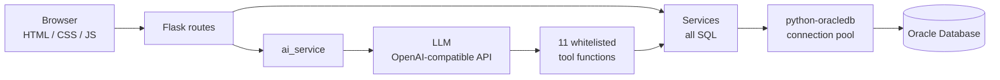

<div align="center">

# 🍔 MunchBite

### AI-Enabled Online Food Ordering Management System

**Oracle Database · Python Flask · AI Food Assistant**


University **Database Systems Practical (SW-215) – Open-Ended Lab** project
Mehran University of Engineering and Technology, Khairpur · Department of Software Engineering

</div>

---

## 📑 Table of Contents

- [Problem Statement](#-problem-statement)
- [Objectives](#-objectives)
- [Features](#-features)
- [AI Chatbot](#-ai-chatbot)
- [Architecture](#-architecture)
- [Database Design](#-database-design)
- [Project Structure](#-project-structure)
- [Installation](#-installation)
- [Environment Variables](#-environment-variables)
- [Demo Accounts](#-demo-accounts)
- [Sample Chatbot Queries](#-sample-chatbot-queries)
- [Security](#-security)
- [Team](#-team)
- [Troubleshooting](#-troubleshooting)
- [Future Improvements](#-future-improvements)

---

## 🔍 Problem Statement

Many restaurants still take orders over the phone or through chat, which creates real operational problems:

- ❌ **Order errors**: items, quantities and addresses are easily recorded incorrectly.
- ❌ **Scattered records**: menus, payments and deliveries are not kept in one place.
- ❌ **Limited insight**: reviews and sales reports are hard to get.
- ❌ **Weak customer experience**: customers struggle to find food and get help with orders.

## 🎯 Objectives

- ✅ One centralised, normalised (**3NF**) Oracle database for the whole ordering workflow.
- ✅ **Customer web app**: register/login, browse, cart, order, pay, track delivery, review.
- ✅ **Admin panel**: manage data, update statuses, view reports and support tickets.
- ✅ **AI chatbot** that answers from **live database data** and never invents transactional facts.

## ✨ Features

| 👤 Customer | 🛠️ Admin | 🤖 AI Assistant |
|---|---|---|
| Register and log in | Sales dashboard and SQL reports | Food recommendations |
| Browse restaurants and menu | Manage restaurants, categories, food | Menu search, price, availability |
| Search by keyword, category, price, spice | Update order, payment and delivery status | Order and delivery status |
| Cart and checkout (Cash / Card / Online, simulated) | Assign riders | Cancel an order |
| Track orders and delivery | View reviews and support tickets | Complaints turned into tickets |
| Reviews (1 to 5) and support tickets | Separate admin login | FAQ and review guidance |

## 🤖 AI Chatbot

Floating chat button on every customer page, plus a full page at `/chatbot`.

- 🍛 Food recommendations (spicy / type / budget)
- 🔎 Menu search, price and availability
- 📦 Order and delivery status
- ❌ Cancellation (only when the order is Pending or Confirmed)
- 🎫 Complaints saved to `SUPPORT_TICKET`
- ⭐ FAQ and review guidance (1 to 5)

## 🏗️ Architecture



The LLM can only call **11 whitelisted functions**: `search_food_items`, `get_food_details`, `check_food_availability`,
`get_my_orders`, `get_order_status`, `get_delivery_status`, `cancel_order`, `create_support_ticket`,
`get_restaurant_information`, `get_faq`, `submit_review`.

- 🚫 It **never writes SQL**.
- 🔐 The logged-in `customer_id` is injected by the server from the session. Identity arguments sent by the model are ignored, so one customer cannot read another's data.
- 🛟 If `AI_API_KEY` is missing or the API fails, a **rule-based router** calls the same functions, so the demo still works.

## 🗄️ Database Design

**11 tables** in total: 9 original and 2 added.

| Table | Purpose |
|---|---|
| `CUSTOMER` | Registered customers with hashed passwords |
| `RESTAURANT` | Restaurants and their open/closed status |
| `CATEGORY` | Food categories |
| `FOOD_ITEM` | Menu items, price, availability, spicy flag |
| `ORDERS` | One row per order and its status |
| `ORDER_ITEM` | Items inside an order (**composite primary key**) |
| `PAYMENT` | Payment for an order (**1:1** with order) |
| `DELIVERY` | Delivery details and status (**1:1** with order) |
| `REVIEW` | Customer ratings (1 to 5) and comments |
| `SUPPORT_TICKET` | ➕ Added: AI and customer support tickets |
| `ADMIN_USER` | ➕ Added: admin login |

**Additional columns:** `CUSTOMER.password_hash`, `FOOD_ITEM.description`, `FOOD_ITEM.is_spicy`.
Columns named with Oracle reserved words were renamed (`payment_date`, `review_date`, `review_comment`, `payment_method`).

**Business rules**
- Cancel only while the order is Pending or Confirmed.
- Cancelling a paid order marks the payment as Refunded.
- One restaurant per order.
- Reviews require a delivered order from that restaurant.
- The order total is calculated with `SUM(quantity * unit_price)` and is never stored (3NF).

## 📁 Project Structure

```
food_ordering_system/
├── app.py              # Flask entry point, CSRF, error pages
├── config.py           # Settings loaded from .env
├── db.py               # Oracle connection pool and transactions
├── auth_utils.py       # login_required / admin_required decorators
├── errors.py           # ServiceError and DBError
├── init_db.py          # Creates tables, sample data, demo passwords
├── requirements.txt
├── .env.example
├── database/           # schema.sql, seed.sql, queries.sql
├── routes/             # shop, auth, admin and chatbot blueprints
├── services/           # business logic and all SQL (including ai_service)
├── templates/          # Jinja2 pages
└── static/             # CSS and images
```

## 🚀 Installation

1. Install **Python 3.10+** and an **Oracle 12c+ / 23ai Free** database (identity columns and `FETCH FIRST` are used).
2. Create a database user:
   ```sql
   CREATE USER food IDENTIFIED BY food_pw QUOTA UNLIMITED ON USERS;
   GRANT CREATE SESSION, CREATE TABLE TO food;
   ```
3. Create and activate a virtual environment:
   ```bash
   python -m venv venv
   source venv/bin/activate        # Windows: venv\Scripts\activate
   ```
4. Install dependencies (python-oracledb runs in thin mode, so no Oracle Client is needed):
   ```bash
   pip install -r requirements.txt
   ```
5. Copy `.env.example` to `.env` and fill in the values.
6. Create the tables and load sample data (⚠️ **drops and recreates** the project tables):
   ```bash
   python init_db.py
   ```
7. Run the app and open http://127.0.0.1:5000
   ```bash
   python app.py
   ```

## ⚙️ Environment Variables

| Variable | Description |
|---|---|
| `ORACLE_USER` | Database user |
| `ORACLE_PASSWORD` | Database password |
| `ORACLE_DSN` | e.g. `localhost:1521/FREE` (or `/XEPDB1` for XE) |
| `SECRET_KEY` | Long random string for sessions |
| `AI_API_KEY` | Key for any OpenAI-compatible provider (optional) |
| `AI_BASE_URL` | Default OpenAI. Groq, OpenRouter and Gemini's OpenAI endpoint also work |
| `AI_MODEL` | Model name |

> 🔒 Never commit `.env`.

## 🔑 Demo Accounts

| Role | Login | Password |
|---|---|---|
| Customer | `ali@example.com` (also `sara@`, `bilal@`, `ayesha@example.com`) | `password123` |
| Admin | `/admin/login` → `admin` | `admin123` |

> ⚠️ Change these for anything beyond a demo.

## 💬 Sample Chatbot Queries

Log in as Ali, then try:

- `I want spicy chicken food under 700`
- `Show me burgers`
- `How much is chicken pizza?`
- `Is chicken biryani available?` (Karachi Bites' version is marked unavailable in the seed data)
- `Where is my order?`
- `I want to cancel my order` (Ali's active order is Out for Delivery, so cancellation is refused with the reason)
- `I received the wrong food`
- `How can I place an order?`
- `Show me Sara's order` (refused)

## 🛡️ Security

- 🧱 Bind variables for every query with user input
- 🔑 scrypt-hashed passwords
- 🍪 Session authentication with HttpOnly, SameSite cookies
- 👤 Per-customer ownership checks in SQL
- 🧑‍💼 Separate admin session
- 🛑 CSRF token on every POST (including the chat API)
- ↪️ Safe redirects
- 🙈 Raw database errors are logged, never shown
- ✂️ Chat input length limits
- 🤖 LLM limited to whitelisted tools

> Note: chat history is kept in server memory (resets on restart). That is fine for a demo; use a table or Redis for production.

## 👥 Team

🎓 **Supervisor:** Dr. Asad Raza Malik, Department of Software Engineering, MUET Khairpur

| Member | Roll No. | Responsibility |
|---|---|---|
| Raju Kumar | K25SW027 | Requirements, problem statement, documentation |
| Zafarullah | K25SW035 | ERD, database design, normalization |
| Nasrullah | K25SW29 | Oracle SQL, tables, constraints, sample data, queries |
| Mohsin Ali | K25SW044 | Python application, Oracle connectivity, testing |
| Danish Ali | K25SW36 | Report writing, screenshots, presentation |

## 🧰 Troubleshooting

| Problem | Fix |
|---|---|
| `DPY-6005` or a 503 page | Check that Oracle is running, and verify `ORACLE_DSN` and credentials |
| `ORA-01950` no privileges on tablespace | Grant quota to the user |
| `ORA-00955` / `ORA-02264` | Re-run `python init_db.py` (it drops old tables first) |
| Chatbot replies look basic | `AI_API_KEY` is not set or the API call failed, so check the server log |

## 🔮 Future Improvements

- 💳 Real payment gateway
- 🛵 Live rider tracking and ETA
- 💾 Persistent chat history
- 🖼️ Image uploads for menu items
- 🛒 Multi-restaurant carts
- 👮 Role-based admin accounts
- 🧪 Automated tests

---

<div align="center">

Made with ❤️ by the MunchBite team · Database Systems Practical, MUET Khairpur

</div>